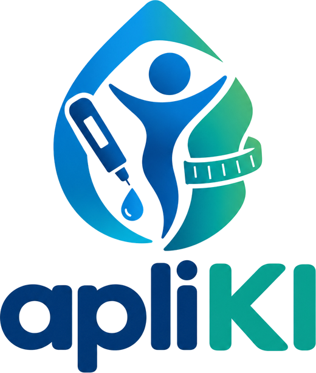

<p align="center">
  
</p>

<h1 align="center">apliKI</h1>

<p align="center">
  Acompanhamento do tratamento semanal com GLP-1: dose, peso, água, nutrição com IA e treinos, num só lugar.
</p>

<p align="center">
  <strong>Código-fonte disponível · Uso exige assinatura do apliKI · <a href="LICENSE">Licença</a></strong>
</p>

> ⚠️ O apliKI é uma ferramenta de acompanhamento pessoal e **não substitui orientação médica**.

---

## Este repositório é source-available, não open source

Você pode ver o código, fazer um fork e **personalizar o app do seu jeito** (cores, telas, textos, layout). Mas:

- o app **continua usando o servidor oficial do apliKI**: não dá para trocar o backend;
- **toda pessoa que usar precisa de uma assinatura ativa** do apliKI (a primeira entrada ganha 7 dias de teste grátis);
- não é permitido redistribuir, vender, publicar em lojas, fazer engenharia reversa do servidor nem usar IA para copiar ou reescrever a lógica do app.

Os detalhes estão em [LICENSE](LICENSE) e em [AI_POLICY.md](AI_POLICY.md).

O servidor do apliKI (regras de segurança, serviço de IA, painel administrativo e controle de assinaturas) **não faz parte deste repositório**. A assinatura é conferida no servidor: remover a tela de assinatura do app não libera o acesso.

## Funcionalidades

- **Início:** próxima dose com contagem regressiva, peso e IMC, água, calorias e macros, atividades, sequência de dias, conquistas e Elo da saúde.
- **Doses:** histórico, rodízio do local de aplicação, controle da caneta, lembretes de dose e de suplementos.
- **Peso:** gráfico de evolução, fotos de progresso na nuvem e montagem de antes e depois.
- **Nutrição:** diário por data, refeições favoritas e **análise de refeições por IA**.
- **Treinos:** biblioteca de exercícios, montagem de treinos, programas prontos, plano inteligente e recuperação muscular.
- **Perfil:** metas, notificações, sintomas, bloqueio por biometria, exportação em PDF e CSV.

## Stack

Expo SDK 57 · React Native 0.86 · React 19 · TypeScript · React Navigation · Zustand · Firebase (Auth + Firestore) · expo-notifications.

## Rodando o seu fork

Pré-requisitos: Node.js 20+, npm e o app **Expo Go** no celular (ou um emulador).

```bash
npm install
npx expo start
```

Escaneie o QR code com o Expo Go. Entre com a sua conta do apliKI (ou crie uma: ela já vem com 7 dias de teste). Quando o teste ou a assinatura vencer, o app mostra a tela para assinar.

Testes e verificação de tipos:

```bash
npm test
npx tsc --noEmit
```

## O que personalizar

| Quero mudar | Onde |
| --- | --- |
| Cores, espaçamentos, fontes | `src/shared/theme.ts` |
| Botões, cartões e outros componentes | `src/shared/components/` |
| Telas | `src/features/<área>/` |
| Abas e navegação | `src/navigation/RootNavigator.tsx` |
| Ícone, logo e splash | `assets/` e `app.json` |

Não altere `src/firebase/config.ts`, `src/firebase/subscription.ts`, `src/store/useSubscriptionStore.ts` nem `src/shared/subscriptionContact.ts`: eles ligam o app ao serviço oficial e à assinatura.

## Contribuindo

Pull requests com correções e melhorias de interface são bem-vindos. Ao enviar uma contribuição você concorda com a seção 2(d) da [licença](LICENSE).

## Assinatura e contato

Para assinar ou pedir autorização para algo que a licença não cobre: [github.com/gabrielsoares97](https://github.com/gabrielsoares97).
